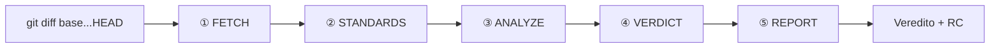

# diffs-reviewer

**Skill focada na review de PR local sem integração com o github.**


---

Skill para o Cursor Agent que revisa o diff da branch atual contra a base (`git diff base...HEAD`). Roda no repo aberto, usa só comandos git de leitura e **não altera código**.

No final: **veredito** + relatório com comentários **RC** prontos para colar no PR.



Progresso: `[Fase 1/5]` … `[Fase 5/5]`

---

## O que faz

| Fase | Função |
|------|--------|
| **FETCH** | Resolve base (origin/<base>), faz fetch restrito, filtra lockfiles/gerados, lê a intenção dos commits, classifica tamanho |
| **STANDARDS** | Carrega regras documentadas + convenções do módulo |
| **ANALYZE** | IMPORT-CHECK em lote, lógica, intenção da PR, segurança, over-engineering com evidência (typecheck sob pedido) |
| **VERDICT + REPORT** | Classifica achados, emite veredito e RC em todo achado |

---

## Instalar

```bash
git clone https://github.com/cardo/diffs-reviewer.git ~/.cursor/skills/diffs-reviewer
```

Windows: `$env:USERPROFILE\.cursor\skills\diffs-reviewer`

Abra o **repo a revisar** no Cursor. Invocação **manual** — não roda sozinha.

---

## Usar

```
/diffs-reviewer
/diffs-reviewer base=develop
```

Também: `Revisar PR` · `review de código` · `analisar diff`

Base auto: `main` → `master` → `origin/HEAD`. Override: `base=<branch>`.
Faz fetch e compara com `origin/<base>` (não precisa dar pull); o único comando de rede é `git fetch --no-tags origin <base>`.
Typecheck completo: peça explicitamente ("rodar typecheck") — roda em background, timeout de 120s, saída filtrada aos arquivos do diff.

---

## Output

### Veredito

| | Resultado | Quando |
|---|---|---|
| ✅ | **Aprovado** | 0 bloqueantes, 0 ressalvas |
| ⚠️ | **Aprovado com ressalvas** | 0 bloqueantes, 1+ ressalvas |
| ❌ | **Reprovado** | 1+ bloqueantes |

Bloqueante → sempre **Reprovado** (nunca ressalvas).

### RC

```
RC: Parece que [observação concreta], poderia verificar por favor?
```

Todo achado traz **RC** pronto. Idioma segue a conversa.

| Seção | Conteúdo |
|-------|----------|
| **Bloqueantes** | Erros de tipo, bugs de lógica, vulnerabilidades |
| **Ressalvas** | Over-engineering, inconsistência de padrão |
| **Sugestões** | Melhorias opcionais de legibilidade ou design |

---

## O que analisa

| Eixo | Detecta |
|------|---------|
| **IMPORT-CHECK** | Import/export inexistente, arquivo removido ainda importado, pacote não declarado *(sempre)* |
| **TYPECHECK** | *Opt-in:* script do projeto → `tsc -p` / `tsc -b` por package |
| **Lógica** | Condições erradas, null unsafe, race, validação bypassável |
| **Segurança** | Injection, XSS, secrets, auth ausente |
| **Padrões** | `.cursor/rules/`, `CONTRIBUTING.md`, convenções do módulo |
| **Over-engineering** | Abstração morta, plugin duplicado, middle man — com evidência *(sempre)* |

TYPECHECK (sob pedido): **script** → **tsc por package** → **skip** (com nota).

---

## Escala adaptativa

| Scope | PR | Comportamento |
|-------|-----|---------------|
| **Small** | ≤3 arquivos, ≤100 linhas | Agente único, diff completo |
| **Medium** | entre Small e Large | Agente único; hunks se >400 linhas |
| **Large** | 11+ ou >500 linhas | Agente único, hunks por arquivo |

Linhas contadas só nos arquivos filtrados (lockfiles não contam).

**Workers ANALYZE** só em PRs muito grandes (≥25 arquivos ou >1500 linhas), com confirmação: ficam mais rápidos, mas gastam mais tokens. IMPORT-CHECK e a reverificação de bloqueantes ficam sempre no agente principal.

---

## Testes

```bash
node tests/check-recipes.js
```

Monta um repo temporário com problemas plantados e valida as receitas do `analyze.md` (copiadas do próprio texto). `--keep` mantém o fixture para um smoke test manual; resultado esperado em `tests/expected-review.md`.

---

## Changelog

- **1.2.0** — menos tokens e menos comandos: IMPORT-CHECK em lote, `ls-tree` sempre filtrado, TYPECHECK em arquivo próprio (só sob pedido) e sem worker, VERDICT+REPORT num arquivo, peers por trecho, lockfiles fora da contagem. Qualidade: intenção da PR via commits, inferência coerente em Small, allowlist única, trigger removido, workers só em PRs muito grandes com reverificação de bloqueantes. Teste de regressão `tests/check-recipes.js`.
- **1.1.1** — greps de símbolo seguros para nomes com `$`; `export type { } from` coberto no IMPORT-CHECK; contagem do IMPORT-CHECK definida (pós-dedup, N = B + R + I); TYPECHECK combina erros e falha de config por package.
- **1.1.0** — IMPORT-CHECK determinístico; TYPECHECK opt-in; over-engineering com verificação ativa; comparação com `origin/<base>` e `git fetch --no-tags origin <base>` restrito.
- **1.0.0** — versão inicial.

---

Feito por **cardosoGu**
