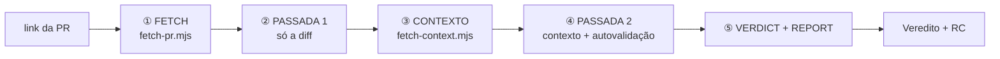

# diffs-reviewer

**Review de PR do GitHub a partir do link, somente leitura.**

---

Skill que revisa uma PR do GitHub pelo link. Coleta tudo via `gh` com dois scripts Node e **nunca age na PR**: não comenta, não envia review, não altera nada — mesmo que você peça durante a review.

No final: **veredito** + relatório com comentários **RC** prontos para colar na PR.



Progresso: `[Fase 1/5]` … `[Fase 5/5]`

---

## O que faz

| Fase | Função |
|------|--------|
| **FETCH** | `fetch-pr.mjs`: metadados, intent (body da PR), diff por arquivo, árvore do repo, exclusões fixas, escopo. PR fechada/mergeada/draft → para e pede confirmação |
| **PASSADA 1** | Só a diff: lógica, intenção, segurança, tipos evidentes |
| **CONTEXTO** | `fetch-context.mjs`: até 10 arquivos pedidos, docs de padrões, espelho do módulo, **IMPORT-CHECK** determinístico |
| **PASSADA 2** | Padrões, over-engineering com evidência, rastreio de contexto, **autovalidação** de cada achado |
| **VERDICT + REPORT** | Veredito, RC em todo achado, linhas de Cobertura e Limites |

---

## Requisitos

- [GitHub CLI](https://cli.github.com/) ≥ 2.48, autenticado (`gh auth login`) com acesso de leitura ao repo da PR
- Node ≥ 18

## Instalar

```bash
git clone https://github.com/cardosoGu/diffs-reviewer.git ~/.cursor/skills/diffs-reviewer
```

Windows: `$env:USERPROFILE\.cursor\skills\diffs-reviewer`

Invocação **manual** — não roda sozinha. Não precisa ter o repo da PR aberto.

---

## Usar

```
/diffs-reviewer https://github.com/<owner>/<repo>/pull/<n>
```

Também: `revisar PR <link>` · `revisar só segurança <link>` · `revisar padrões <link>`

---

## Segurança

- O modelo só roda os dois scripts e lê os arquivos que eles gravam numa pasta temporária.
- Os scripts só chamam `gh pr view`, `gh pr diff` e `gh api` com GET em três endpoints (arquivos da PR, árvore, conteúdo de arquivo). Uma função única (`runGh`) recusa qualquer outro comando ou flag de escrita, com teste para cada caso.
- Nada é escrito fora de `<tmp>/diffs-reviewer/<owner>__<repo>__pr-<n>`.

---

## Output

### Veredito

| | Resultado | Quando |
|---|---|---|
| ✅ | **Aprovado** | 0 bloqueantes, 0 ressalvas |
| ⚠️ | **Aprovado com ressalvas** | 0 bloqueantes, 1+ ressalvas |
| ❌ | **Reprovado** | 1+ bloqueantes |

### RC

```
RC: Parece que [observação concreta], poderia verificar por favor?
```

Todo achado traz **RC** pronto. Idioma segue a conversa. O relatório termina com:

```
Cobertura: 12 analisados, 30 ignorados por regra (i18n 20, docs 10), 0 não alcançados
Limites: tipos não verificados (sem typecheck); importadores fora da diff e do espelho de arquivos removidos não verificados
```

---

## O que analisa

| Eixo | Detecta |
|------|---------|
| **IMPORT-CHECK** | Caminho inexistente, export nomeado inexistente, arquivo removido ainda importado, pacote não declarado *(sempre, determinístico)* |
| **Lógica** | Condições erradas, null unsafe, race, validação bypassável, divergência com a intenção da PR |
| **Segurança** | Injection, XSS, secrets, auth ausente, assinatura de webhook |
| **Padrões** | `CLAUDE.md`, `AGENTS.md`, `CONTRIBUTING.md`, `.cursor/rules/`, convenções do módulo |
| **Over-engineering** | Abstração morta, plugin duplicado, middle man — com evidência *(sempre)* |

Não roda typecheck nem linter: erros de tipo só quando evidentes na leitura (aparece em `Limites`).

---

## Escopo

| Escopo | PR | Efeito |
|--------|-----|--------|
| **Small** | ≤3 arquivos, ≤100 linhas | STANDARDS leve |
| **Medium** | entre Small e Large | — |
| **Large** | 11+ ou >500 linhas | inferência de padrões em até 6 módulos |

Sempre agente único; linhas contadas só nos arquivos que não foram ignorados.

---

## Testes

```bash
node --test "tests/*.test.mjs"
```

Sem rede: o `gh` é substituído por respostas simuladas. Cobrem a allowlist (inclusive cada ação proibida), parsing de diff, exclusões, extração e resolução de imports, exports e os dois scripts de ponta a ponta.

---

## Changelog

- **2.0.0** — review de PR pelo link, coleta via `gh` em dois scripts Node (2 turnos, chamadas em paralelo), IMPORT-CHECK portado para JS, análise em duas passadas com autovalidação, relatório com Cobertura e Limites. Proibida qualquer ação na PR, com allowlist no código. Removidos: TYPECHECK, workers, fluxo `git fetch`/`git diff`, `base=`.
- **1.2.0** — menos tokens e menos comandos: IMPORT-CHECK em lote, TYPECHECK só sob pedido, workers só em PRs muito grandes, teste de regressão `tests/check-recipes.js`.
- **1.1.1** — greps de símbolo seguros para nomes com `$`; `export type { } from` coberto no IMPORT-CHECK.
- **1.1.0** — IMPORT-CHECK determinístico; TYPECHECK opt-in; over-engineering com verificação ativa.
- **1.0.0** — versão inicial.

---

Feito por **cardosoGu**
