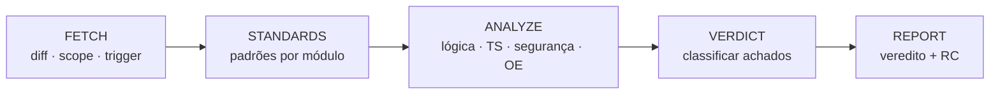

# diffs-reviewer

**Review de PR local no Cursor — read-only, focado no que importa.**


[Instalar](#instalar) · [Usar](#usar) · [Veredito](#veredito) · [Spec](SPEC.md)


## Descrição

O **diffs-reviewer** é uma skill para o Cursor Agent que realiza **revisão de Pull Request local** com base no diff Git entre a branch atual e a branch base (`git diff base...HEAD`).

A execução é **estritamente read-only**: não altera arquivos do repositório, não possui integração com GitHub e utiliza apenas comandos Git de leitura (`diff`, `log`, `show`, `status`, `branch`, `remote`).

Ao concluir a análise, a skill emite um **veredito final** — **Aprovado**, **Reprovado** ou **Aprovado com ressalvas** — e um relatório com:

- **Problemas bloqueantes** — itens que impedem o merge
- **Ressalvas** — melhorias relevantes, sem caráter bloqueante
- **Sugestões** — recomendações opcionais de refinamento
- **RC** — comentário curto pronto para colar no PR (todo achado)

Cada achado inclui referência ao arquivo, trecho de código, justificativa, sugestão de correção e **RC**.




O progresso é exibido por fases: `[Fase 1/5]` … `[Fase 5/5]`.

## Instalar

```bash
git clone https://github.com/cardo/diffs-reviewer.git ~/.cursor/skills/diffs-reviewer
```

No Windows, substitua o caminho por `$env:USERPROFILE\.cursor\skills\diffs-reviewer`.

Abra o **repositório a ser revisado** no Cursor. A skill é invocada manualmente — não executa automaticamente.

## Usar

No chat do Cursor:

```
/diffs-reviewer
/diffs-reviewer base=develop
```

Gatilhos equivalentes: `Revisar PR` · `review de código` · `analisar diff` · `Revisar só segurança` · `Revisar padrões`

A branch base é detectada automaticamente (`main` → `master` → default do `origin/HEAD`). Use `base=<branch>` para sobrescrever.

## Veredito


|     | Resultado                  | Condição                                |
| --- | -------------------------- | --------------------------------------- |
| ✅   | **Aprovado**               | Nenhum problema bloqueante              |
| ⚠️  | **Aprovado com ressalvas** | Sem bloqueantes; ressalvas recomendadas |
| ❌   | **Reprovado**              | Um ou mais problemas bloqueantes        |


**Regra:** na presença de qualquer bloqueante, o veredito é sempre **Reprovado** — nunca *Aprovado com ressalvas*.

### RC (comentário para PR)

Todo achado inclui uma linha **RC** no formato:

```
RC: Parece que [observação concreta], poderia verificar por favor?
```

Tom colaborativo, 1–2 frases, pronto para colar no GitHub. Em conversas em inglês, o template equivalente é usado automaticamente.

### O que entra no relatório


| Seção                     | Descrição                                                                                       |
| ------------------------- | ----------------------------------------------------------------------------------------------- |
| **Problemas bloqueantes** | Erros de TypeScript no diff, bugs de lógica, vulnerabilidades graves, risco de perda de dados   |
| **Ressalvas**             | Over-engineering, inconsistências de padrão, refatorações recomendadas                          |
| **Sugestões**             | Ajustes opcionais de legibilidade, organização ou performance                                   |
| **RC**                    | Comentário PR-ready em cada item das três seções acima                                          |


## O que analisa

- **TypeScript** — `tsc` diff-scoped (só arquivos do diff), sub-agente automático em PRs grandes
- **Lógica** — condições incorretas, null unsafe, validações bypassáveis, condições de corrida
- **Segurança** — injection, XSS, secrets expostos, ausência de autorização
- **Padrões** — regras documentadas (`.cursor/rules/`, `CONTRIBUTING.md`) e convenções inferidas por módulo
- **Over-engineering** — abstração morta, plugin duplicado, middle man, wrapper desnecessário (sempre)

### Performance adaptativa (v2.1)

| Scope  | Comportamento |
| ------ | ------------- |
| Small  | Agente único, TSC inline |
| Medium | Agente único; TSC sub-agente se trigger ligar |
| Large  | Hunks por arquivo; TSC sub-agente; workers ANALYZE **mediante confirmação** |

**Trigger** (sub-agente TSC automático): `(files > 8 AND lines > 400) OR files > 12 OR lines > 800`

**Limites e escopo**

- Não altera o repositório sob revisão
- Considera apenas commits da branch atual (sem mudanças uncommitted/staged)
- Sem integração com GitHub (comentários, checks, API)
- Sem ESLint ou linters automáticos
- Review completa — sem parar no primeiro bloqueante
- Detalhes completos em [SPEC.md](SPEC.md)


---

Feito por **cardosoGu**
