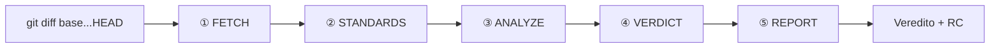

# diffs-reviewer

**Skill focada na review de PR local sem integração com o github.**


---

Skill para o Cursor Agent que revisa o diff da branch atual contra a base (`git diff base...HEAD`). Roda no repo aberto, usa só comandos git de leitura e **não altera código**.

No final: **veredito** + relatório com comentários **RC** prontos para colar no PR.



Progresso: `[Fase 1/5]` … `[Fase 5/5]`

---

## O que faz

| Fase | Função |
|------|--------|
| **FETCH** | Resolve base, obtém diff, classifica tamanho da PR |
| **STANDARDS** | Carrega regras documentadas + convenções do módulo |
| **ANALYZE** | Revisa cada arquivo: typecheck, lógica, segurança, over-engineering |
| **VERDICT** | Classifica achados (bloqueante / ressalva / sugestão) |
| **REPORT** | Emite veredito e RC em todo achado |

---

## Instalar

```bash
git clone https://github.com/cardo/diffs-reviewer.git ~/.cursor/skills/diffs-reviewer
```

Windows: `$env:USERPROFILE\.cursor\skills\diffs-reviewer`

Abra o **repo a revisar** no Cursor. Invocação **manual** — não roda sozinha.

---

## Usar

```
/diffs-reviewer
/diffs-reviewer base=develop
```

Também: `Revisar PR` · `review de código` · `analisar diff`

Base auto: `main` → `master` → `origin/HEAD`. Override: `base=<branch>`.

---

## Output

### Veredito

| | Resultado | Quando |
|---|---|---|
| ✅ | **Aprovado** | 0 bloqueantes, 0 ressalvas |
| ⚠️ | **Aprovado com ressalvas** | 0 bloqueantes, 1+ ressalvas |
| ❌ | **Reprovado** | 1+ bloqueantes |

Bloqueante → sempre **Reprovado** (nunca ressalvas).

### RC

```
RC: Parece que [observação concreta], poderia verificar por favor?
```

Todo achado traz **RC** pronto. Idioma segue a conversa.

| Seção | Conteúdo |
|-------|----------|
| **Bloqueantes** | Erros de tipo, bugs de lógica, vulnerabilidades |
| **Ressalvas** | Over-engineering, inconsistência de padrão |
| **Sugestões** | Melhorias opcionais de legibilidade ou design |

---

## O que analisa

| Eixo | Detecta |
|------|---------|
| **TYPECHECK** | Script do projeto → `tsc -p` / `tsc -b` por package |
| **Lógica** | Condições erradas, null unsafe, race, validação bypassável |
| **Segurança** | Injection, XSS, secrets, auth ausente |
| **Padrões** | `.cursor/rules/`, `CONTRIBUTING.md`, convenções do módulo |
| **Over-engineering** | Abstração morta, plugin duplicado, middle man *(sempre)* |

TYPECHECK: **script** → **tsc por package** → **skip** (com nota).

---

## Escala adaptativa

| Scope | PR | Comportamento |
|-------|-----|---------------|
| **Small** | ≤3 arquivos, ≤100 linhas | Agente único |
| **Medium** | 4–10 arquivos | + TYPECHECK worker se trigger ON |
| **Large** | 11+ ou >500 linhas | Hunks por arquivo + workers ANALYZE *(com confirmação)* |

**Trigger:** `(files > 8 AND lines > 400) OR files > 12 OR lines > 800`

PRs grandes podem usar workers paralelos (contrato genérico, sem depender de runtime específico).

---

Feito por **cardosoGu**
